## Comando Sobre a tabela
---
usamos esse comando para apelidar e fazer contagem de linhas 
```SQL
SELECT COUNT(*) AS 
TOTAL_DE_PRODUTOS
FROM produtos
```
---
## Para selecionar os produtos de naior e maior seria:
```sql
SELECT COUNT(*) AS produtos_abaixo_estoque
WHERE ESTOQUE > 10;
```
---
## usamos para definir qual é o mais caro/barato 
```sql
  SELECT MAX(preco) AS produto_mais_caro,
    MIN(preco) AS produto_mais_barato
    FROM produtos;
```
---
## para a saber a media:
```sql
  SELECT AVG(preco) FROM produtos;
  ```
  ---
  ## para arrumar a media:
  ```sql
  SELECT ROUND(AVG(preco),2) AS preco_medio
FROM produtos;
```
---
 ##  Fazendo a Tabela Aplicando Todos os Comandos:
   ```sql
   SELECT
 COUNT(*) AS total_produtos,
 MIN(preco) AS menor_valor,
 MAX(preco) AS maior_valor,
 ROUND(AVG(preco),2) AS media_valores,
 SUM(estoque) AS total_pecas
 FROM produtos;
 ```
---
## para pegar o total dos produtos:
```sql 
SELECT SUM(estoque) AS total_de_produtos
FROM produtos;
```
---
## saber o total de compras
```sql
SELECT 
SUM(preco*estoque) AS patrimonio_total
FROM produtos;
```


## ATIVIDADE 07

Começamos a criar a tabela mas precisamos de limite então usaremos o comando:
```sql

SELECT * FROM produtos LIMIT 50;
```
 #### A1. Liste o nome e o preço de todos os produtos da categoria Monitores.
```sql
SELECT nome, preco 
FROM produtos 
WHERE categoria = 'Monitores';
```
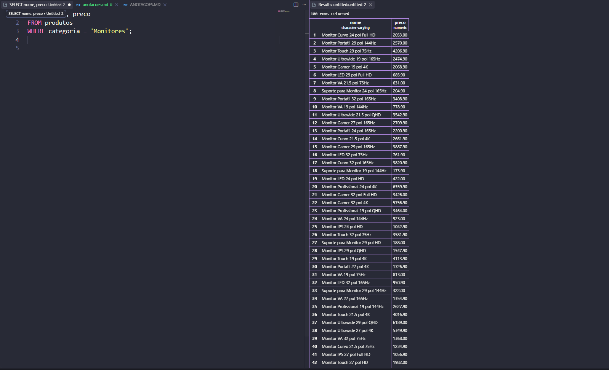

#### A2. Liste todos os produtos com estoque menor que 5 unidades, mostrando nome, categoria e estoque.
 ```sql
SELECT nome, categoria, estoque 
FROM produtos 
WHERE estoque < 5;
```
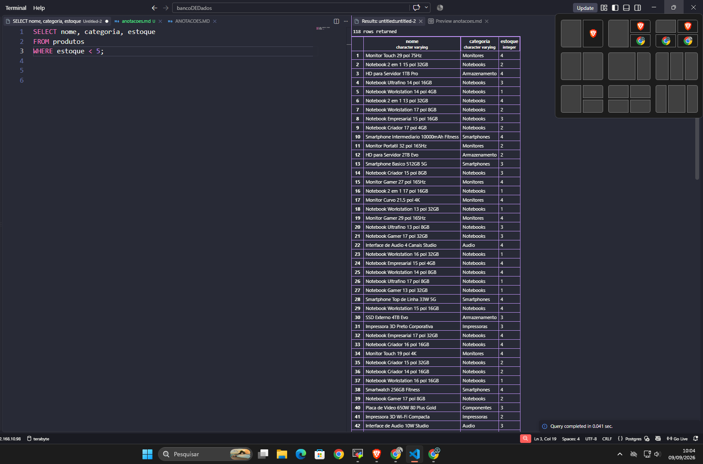

#### A3. Liste os 10 produtos mais caros da loja (nome e preço), do mais caro para o mais barato.
```sql
SELECT nome, preco 
FROM produtos 
ORDER BY preco DESC 
LIMIT 10;
```
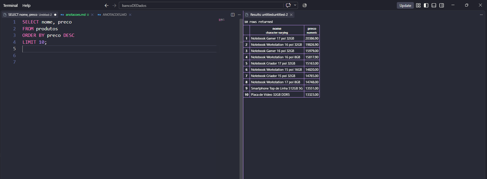

#### A4. Liste os produtos da marca Logitech, ordenados por preço crescente.
```sql
SELECT * 
FROM produtos 
WHERE marca = 'Logitech' 
ORDER BY preco ASC;
```
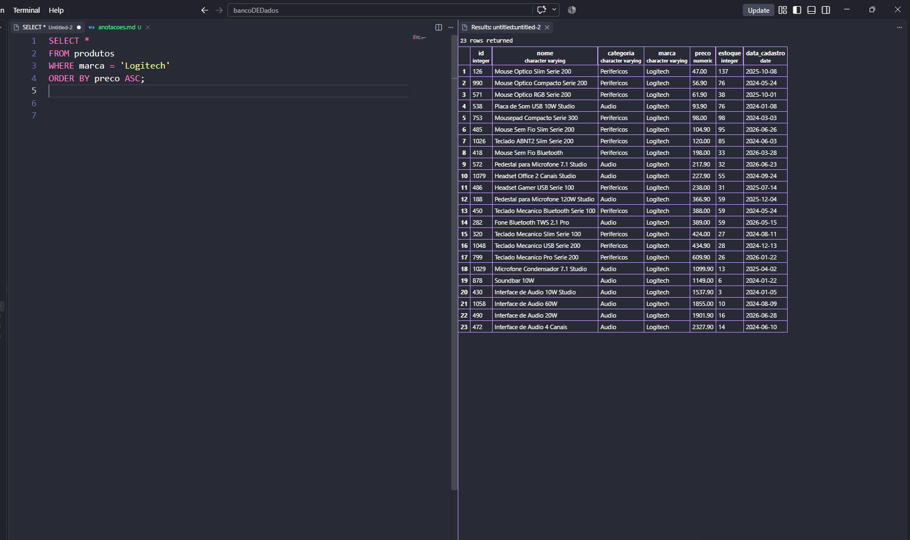

#### A5. Liste os produtos com preço entre R$ 100,00 e R$ 500,00, mostrando nome e preço.
```sql
SELECT nome, preco 
FROM produtos 
WHERE preco BETWEEN 100.00 AND 500.00;
```
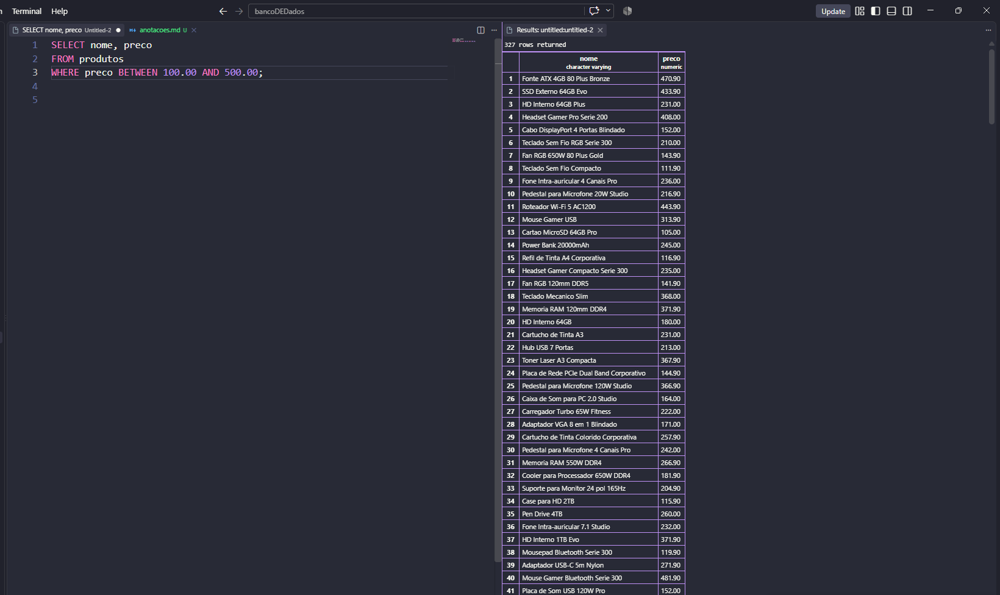

---

## Atividade PARTE B — FUNÇÕES DE AGREGAÇÃO

#### B1. Quantos produtos existem cadastrados na loja? Dê ao resultado o nome total_de_produtos.
```sql
SELECT COUNT(*) AS total_de_produtos 
FROM produtos;
```
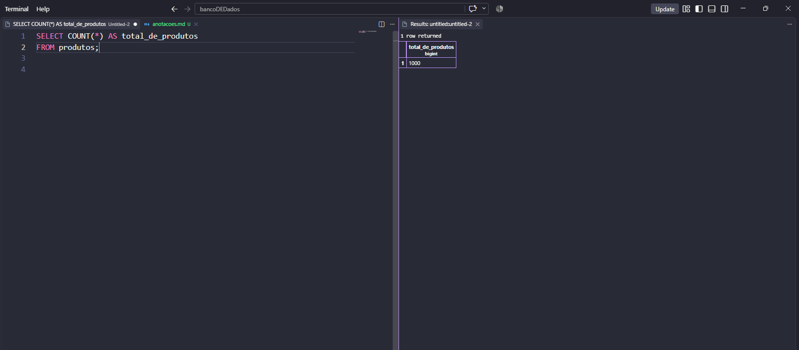


#### B2. Quantos produtos estão com estoque abaixo de 10 unidades? Nomeie a coluna como produtos_em_falta.
```sql
SELECT COUNT(*) AS produtos_em_falta 
FROM produtos 
WHERE estoque < 10;
```
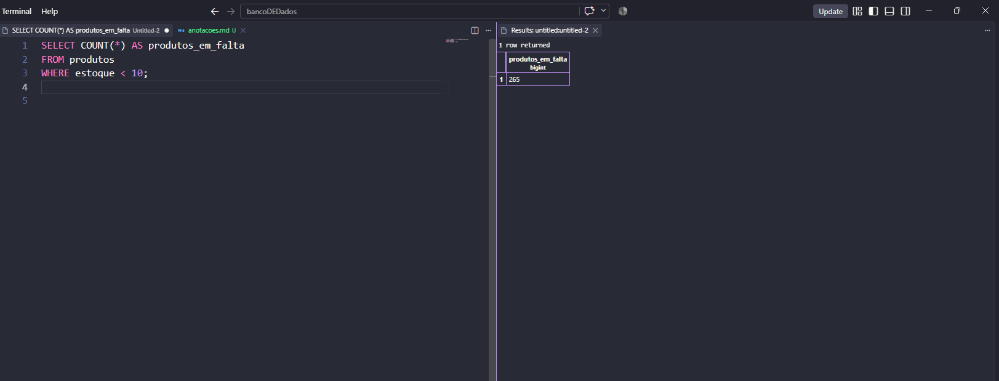


#### B3. Qual o maior e o menor preço da loja? Traga os dois na mesma consulta, com os nomes maior_preco e menor_preco.
```sql
SELECT 
    MAX(preco) AS maior_preco, 
    MIN(preco) AS menor_preco 
FROM produtos;
```
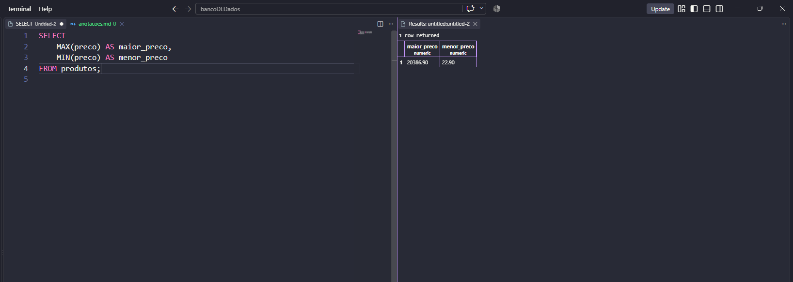

#### B4. Qual o preço médio dos produtos da categoria Notebooks, arredondado para 2 casas decimais?
```sql
SELECT ROUND(AVG(preco), 2) AS preco_medio 
FROM produtos 
WHERE categoria = 'Notebooks';
```
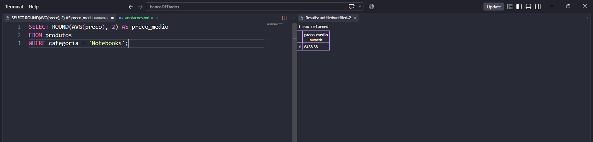


#### B5. Quantas peças a loja tem no total, somando o estoque de todos os produtos? Nomeie como total_de_pecas.
```sql
SELECT SUM(estoque) AS total_de_pecas 
FROM produtos;
```
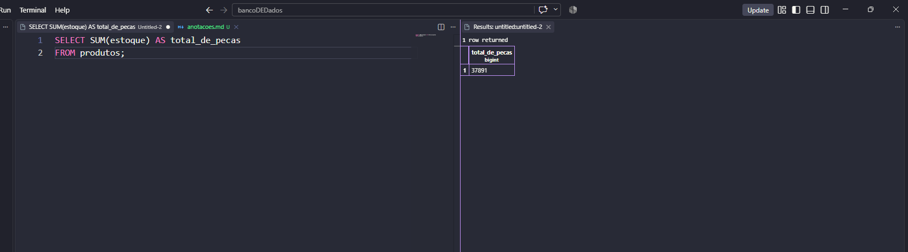

---

## ATIVIDADE PARTE C — PAINEL E CÁLCULOS

#### C1. Monte um painel resumo em uma única consulta, retornando de uma vez: quantidade de produtos, preço médio (2 casas decimais), maior preço, menor preço e total de peças em estoque. Todas as colunas devem ter nomes compreensíveis para o gerente.
```SQL
SELECT 
    COUNT(preco) AS quantidade_de_produtos,
    ROUND(AVG(preco), 2) AS preco_medio,
    MAX(preco) AS maior_preco,
    MIN(preco) AS menor_preco,
    SUM(estoque) AS total_de_pecas_em_estoque
FROM produtos;
```
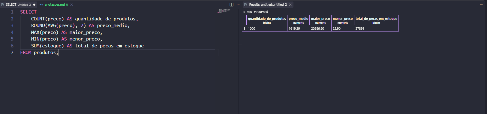

#### C2. O valor imobilizado de um produto não está gravado na tabela: ele precisa ser calculado (preço x estoque). Crie a coluna calculada valor_em_estoque e mostre os 5 produtos com maior valor imobilizado, exibindo nome, preço, estoque e o valor calculado.
```SQL
SELECT 
    nome,
    preco,
    estoque,
    (preco * estoque) AS valor_em_estoque
FROM 
    produtos
ORDER BY 
    valor_em_estoque DESC
LIMIT 5;

```
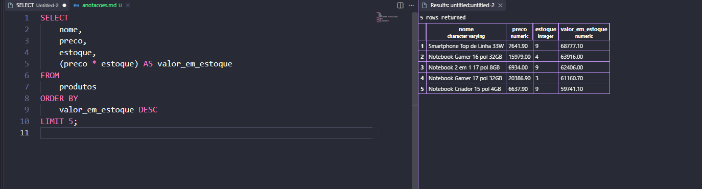


#### C3. Compare o resultado de C2 com o produto mais caro que apareceu em A3. É o mesmo item? Escreva duas linhas explicando o que essa comparação revela sobre o estoque da loja
```
Sim, é o mesmo produto  o mais caro (A3) também é o que tem maior valor imobilizado (C2). Isso mostra que a loja tem bastante dinheiro parado justamente no item mais caro, o que pode ser um ponto de atenção pro estoque.

```


