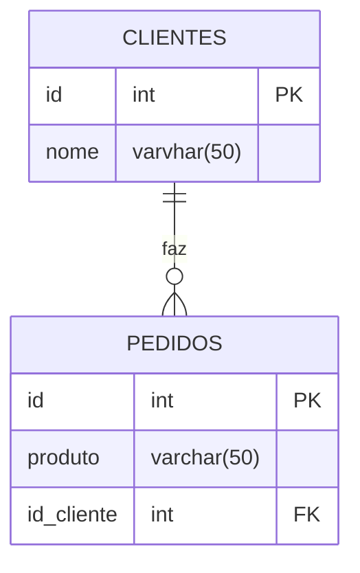

## Relacionamentos entre tabelas 

- Ideia principal: um cliente possui varios pedidos.

## Diagrama 



**1. Primeiro, criamos a nossa tabela:**
```sql
CREATE TABLE clientes(
    id SERIAL PRIMARY KEY,
    nome VARCHAR(50) NOT NULL
);
```

**2. Criamos a tabela pedidos, referenciando a coluna ID da tabela clientes:**
```sql
CREATE TABLE pedidos(
    id SERIAL PRIMARY KEY,
    produto VARCHAR(50) NOT NULL,
    id_cliente INT REFERENCES clientes(id)
);
```

**3. Inserimos clientes para nossas tabelas clientes**
```sql
INSERT INTO clientes (nome) VALUES
('hannah'),
('miguel'),
('murilo'),
('lucas');
```
**4. Iremos os pedidos e seus respectivos clientes:**
```sql
INSERT INTO pedidos (produto,id_cliente) VALUES
('chocolate',3),
('salgado',1),
('refri',2),
('chocolate',1);
```
---
**5. Para verificar quais o clinete comprou até que ficaram sem nada:**
```sql
SELECT clientes.nome,pedidos.produto
FROM pedidos
INNER JOIN clientes ON pedidos.id_cliente = clientes.id;
```
**7. Para aparecer so o cliente que não fez o pedido:**
```sql
SELECT clientes.nome,pedidos.produto
FROM clientes
LEFT JOIN pedidos ON pedidos.id_cliente = clientes.id
WHERE pedidos.id IS NULL;
```