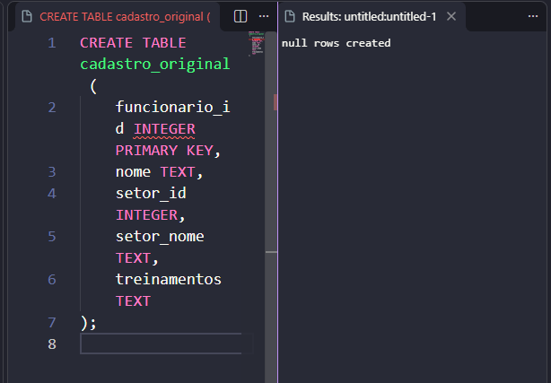
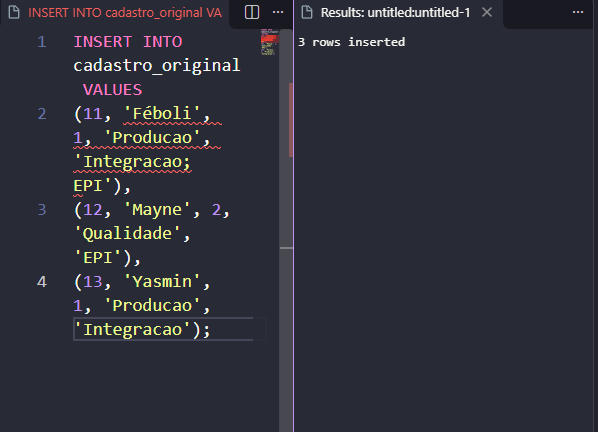
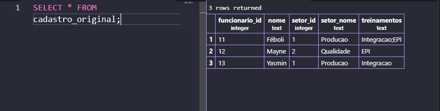
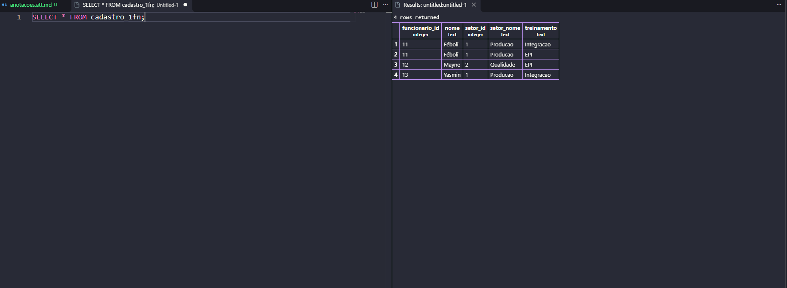
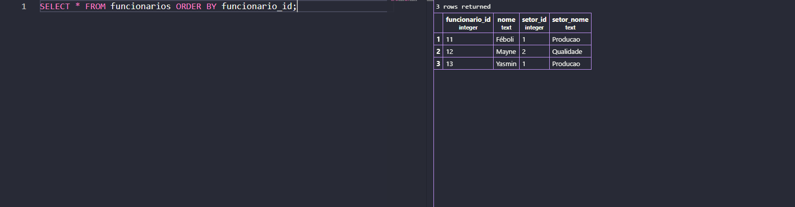
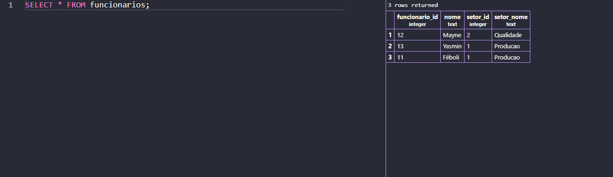

### Criar o banco de dados

```sql
CREATE DATABASE manutec_treinamentos;
```


### criar a tabela original e inserir os dados

```sql
CREATE TABLE cadastro_original (
    funcionario_id INTEGER PRIMARY KEY,
    nome TEXT,
    setor_id INTEGER,
    setor_nome TEXT,
    treinamentos TEXT
);



INSERT INTO cadastro_original VALUES
(11, 'Féboli', 1, 'Producao', 'Integracao;EPI'),
(12, 'Mayne', 2, 'Qualidade', 'EPI'),
(13, 'Yasmin', 1, 'Producao', 'Integracao');
```


resultado:

```sql
SELECT * FROM cadastro_original;
```

Resultado de SELECT * FROM cadastro_original;



---

## 1. Primeira Forma Normal (1FN)

Objetivo: cada linha com um único treinamento, sem perder nenhuma participação. Chave composta: `(funcionario_id, treinamento)`.

### Criar `cadastro_1fn` separando o campo `treinamentos` no `;`

```sql
CREATE TABLE cadastro_1fn AS
SELECT
    funcionario_id,
    nome,
    setor_id,
    setor_nome,
    TRIM(t.treinamento) AS treinamento
FROM cadastro_original,
     UNNEST(string_to_array(treinamentos, ';')) AS t(treinamento);
```

### Definir a chave primária composta

```sql
ALTER TABLE cadastro_1fn
    ADD PRIMARY KEY (funcionario_id, treinamento);
```

### Consultar o resultado

```sql
SELECT * FROM cadastro_1fn ORDER BY funcionario_id, treinamento;
```

 Criação de cadastro_1fn e definição da chave primária


Resultado de SELECT * FROM cadastro_1fn;



### Verificação 

```sql
SELECT COUNT(*) AS total_participacoes FROM cadastro_1fn;
```

Verificar Contagem de participações 


---

## 2. Segunda Forma Normal (2FN)

Objetivo: eliminar dependências parciais. Os dados do funcionário (que dependem só de `funcionario_id`) ficam separados das participações.

### Criar funcionarios com DISTINCT

```sql
CREATE TABLE funcionarios AS
SELECT DISTINCT
    funcionario_id,
    nome,
    setor_id,
    setor_nome
FROM cadastro_1fn;
```

### Criar `participacoes`

```sql
CREATE TABLE participacoes AS
SELECT
    funcionario_id,
    treinamento
FROM cadastro_1fn;
```

### Definir chaves primárias e chave estrangeira

```sql
ALTER TABLE funcionarios
    ADD PRIMARY KEY (funcionario_id);

ALTER TABLE participacoes
    ADD PRIMARY KEY (funcionario_id, treinamento);

ALTER TABLE participacoes
    ADD CONSTRAINT fk_participacoes_funcionario
    FOREIGN KEY (funcionario_id)
    REFERENCES funcionarios (funcionario_id);
```

### Consultar as duas tabelas

```sql
SELECT * FROM funcionarios ORDER BY funcionario_id;

SELECT * FROM participacoes ORDER BY funcionario_id, treinamento;
```

Criação de `funcionarios` e `participacoes`

 

Definição das chaves primárias e da chave estrangeira


Resultado de `SELECT * FROM funcionarios;



Resultado de SELECT * FROM participacoes;


---

## 3. Terceira Forma Normal (3FN)

objetivo: eliminar dependência transitiva. `setor_nome` depende de `setor_id`, e não de `funcionario_id`, então vai para uma tabela própria.

### Criar `setores` (sem linhas repetidas)

```sql
CREATE TABLE setores AS
SELECT DISTINCT
    setor_id,
    setor_nome
FROM funcionarios;
```

### Definir a chave primária de setores

```sql
ALTER TABLE setores
    ADD PRIMARY KEY (setor_id);
```

### Consultar os setores antes de continuar

```sql
SELECT * FROM setores ORDER BY setor_id;
```

Criação de 'setores' e chave primária:


 Resultado de SELECT * FROM setores;


### Adicionar a chave estrangeira em funcionarios e exigir setor_id

```sql
ALTER TABLE funcionarios
    ADD CONSTRAINT fk_funcionarios_setor
    FOREIGN KEY (setor_id)
    REFERENCES setores (setor_id);

ALTER TABLE funcionarios
    ALTER COLUMN setor_id SET NOT NULL;
```

### Retirar somente a coluna setor_nome de funcionarios

```sql
ALTER TABLE funcionarios
    DROP COLUMN setor_nome;
```

Chave estrangeira, `NOT NULL` e remoção de `setor_nome`**


### Consultar as três tabelas finais

```sql
SELECT * FROM setores ORDER BY setor_id;

SELECT * FROM funcionarios ORDER BY funcionario_id;

SELECT * FROM participacoes ORDER BY funcionario_id, treinamento;
```

verificação do resultado: SELECT * FROM setores;


SELECT * FROM funcionarios;


SELECT * FROM participacoes;


